# Architecture

## Modules

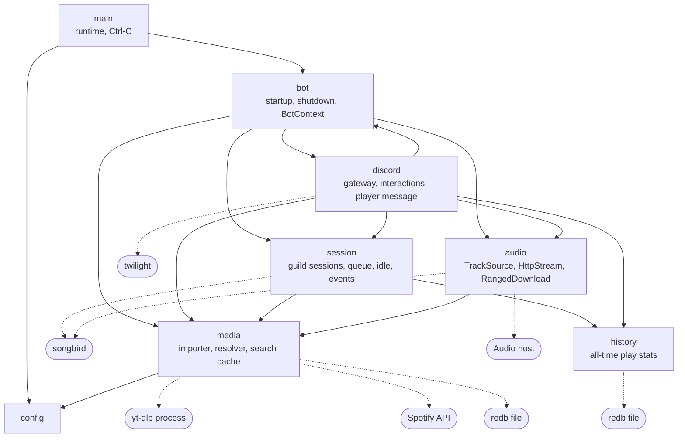

## What lives how long

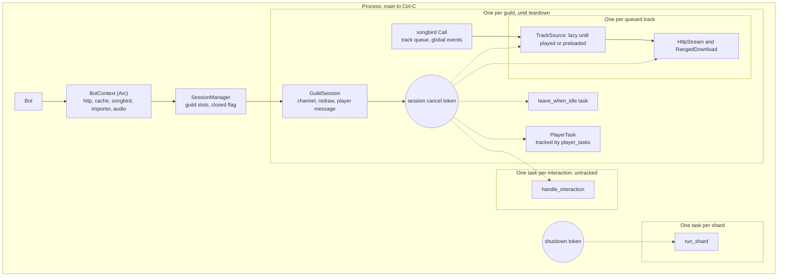

## Session lifecycle

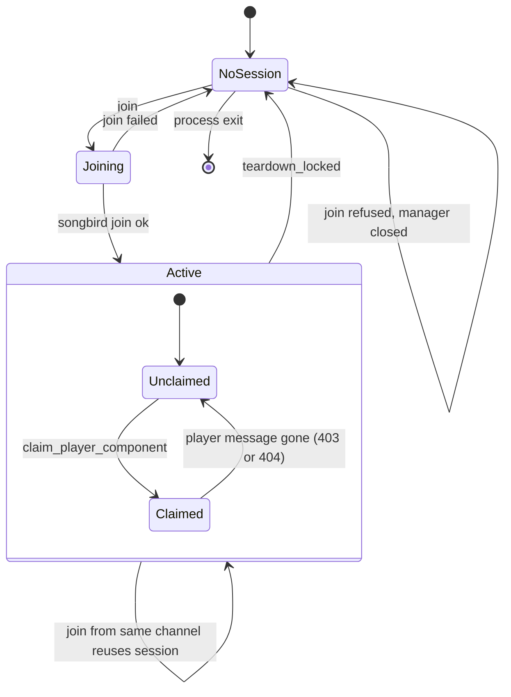

### What teardown does

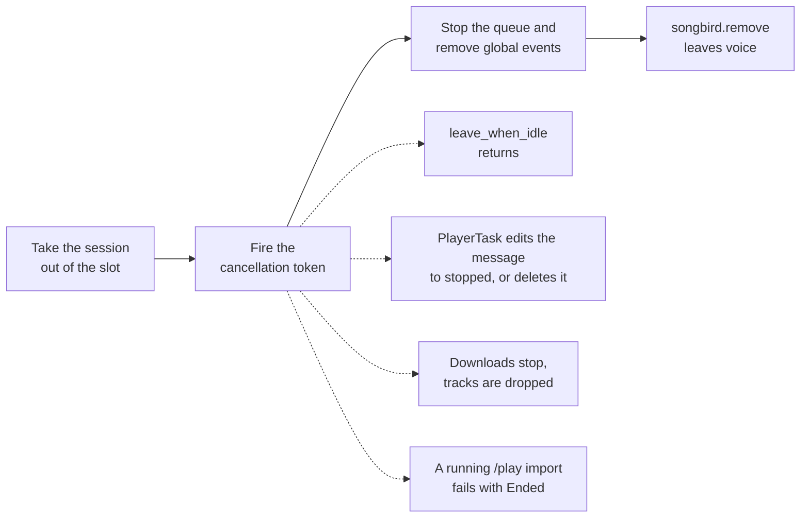

## Where events come in

There are two entry points: the Discord gateway, once per shard, and songbird's
per-call events.

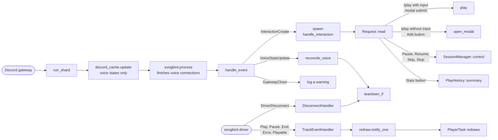

## Sequence diagram of /play

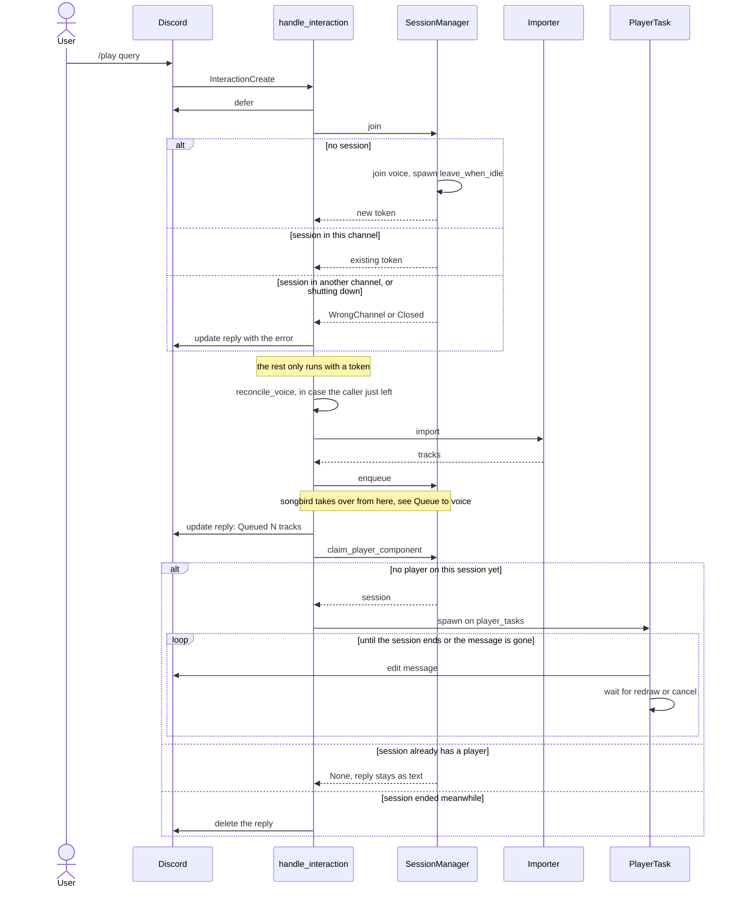

## Import and resolve

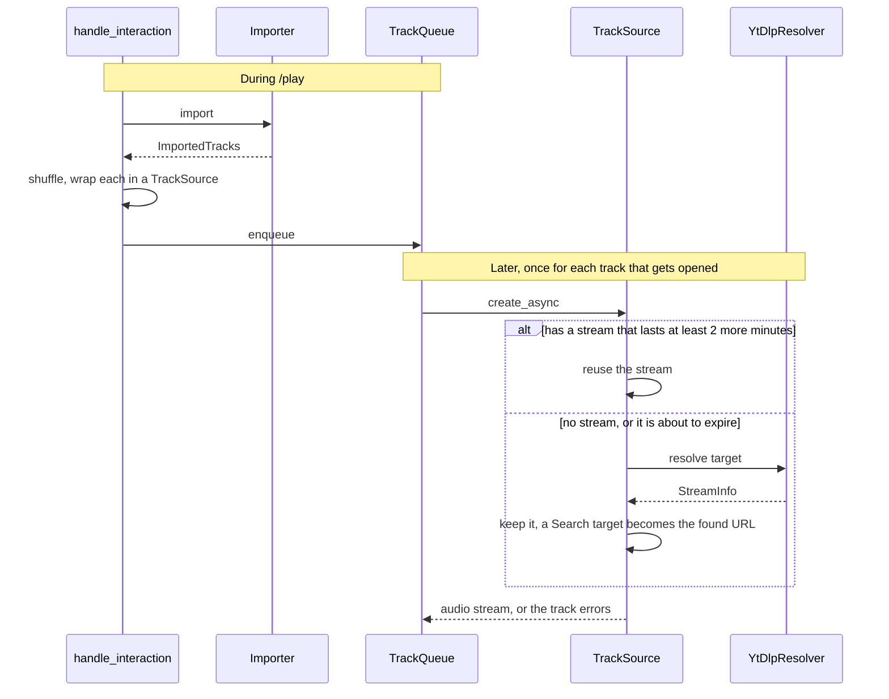

### How a target resolves

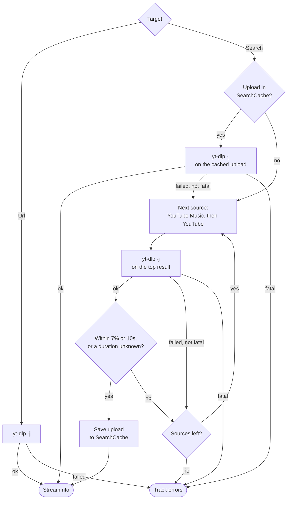

## Queue to voice

songbird owns the queue. `enqueue` hands it every track straight away, paused
and unopened, so a long playlist costs no downloads. The tracks advance through
events that songbird attaches to each track. slap never starts the next track
itself: Skip only stops the current one, which fires the same `End` event.

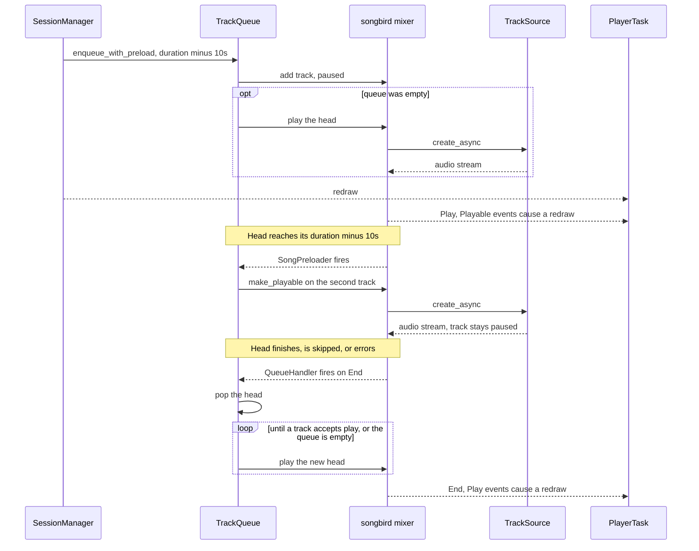

## Audio pipeline

Reading is pull-based. The mixer drains the ring buffer, and when that buffer is
full, nothing polls the `HttpStream`, so no new window is requested. A preloaded
track that hasn't started waits this way, holding roughly one budget of audio.

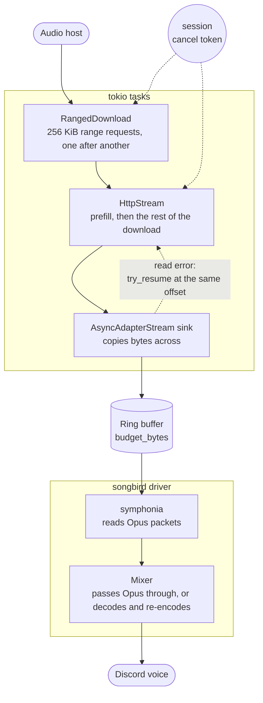

## Shutdown

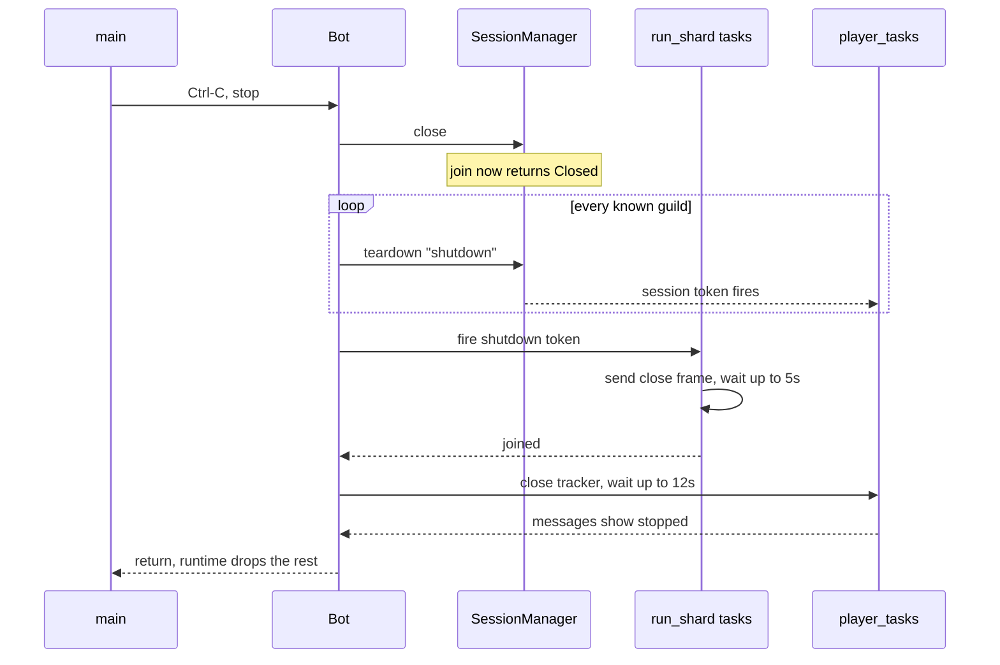